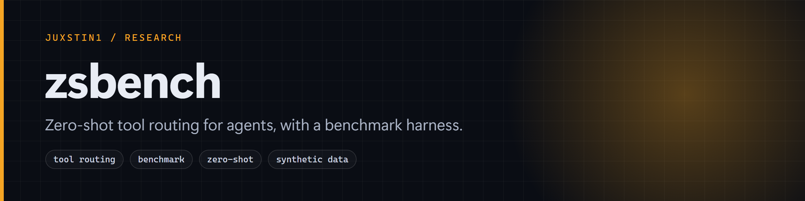
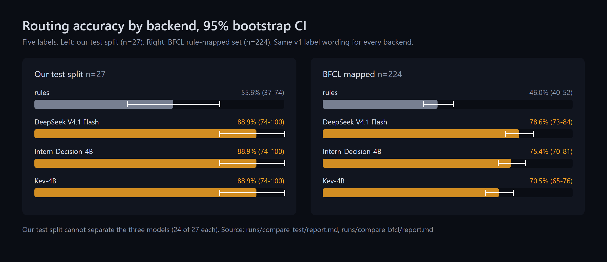

<p align="center"></p>

**A zero-shot router that picks an agent's next action, plus the harness that measures it.**

<p align="center"></p>

*Routing accuracy with 95% bootstrap CIs, from `runs/compare-test/report.md` and `runs/compare-bfcl/report.md`.*

## What it does

- Routes one user request to one of five labels: `answer_directly`, `web_search`, `read_file`, `run_code`, `ask_user`.
- Compares backends on the same gold set: regex `rules`, an `llm` generating JSON, and Jev-style logit scorers.
- Reports accuracy with bootstrap CIs, per-label F1, calibration (ECE) and label-order bias.
- Splits gold into dev and test; test errors are never shown.
- Generates hard synthetic rows with several models, blind-checks them, and keeps gold apart from training data.
- Ships a production router: DeepSeek V4.1 Flash on DeepInfra, frozen v1 label wording.

## Results

| backend | our test (n=27) | BFCL mapped (n=224) |
|---|---|---|
| rules | 55.6% (37-74) | 46.0% (40-52) |
| DeepSeek V4.1 Flash | 88.9% (74-100) | 78.6% (73-84) |
| Intern-Decision-4B | 88.9% (74-100) | 75.4% (70-81) |
| Kev-4B | 88.9% (74-100) | 70.5% (65-76) |

- Source: [compare-test](runs/compare-test/report.md), [compare-bfcl](runs/compare-bfcl/report.md), summary in [docs/jev-landscape.md](docs/jev-landscape.md).
- Our test split is 27 rows. It cannot separate the three models; the CI spans about 26 points.
- BFCL labels come from fixed rules in `scripts/map_bfcl.py`. They are noisy, and the set has no `read_file` or `ask_user` rows.
- Both local models lean on averaging over label order. Asked once, Intern falls to 66.7% on our test and flips 33% of answers.
- On the 42-row gold set, DeepSeek scores 92.9% vs 57.1% for rules ([gold42-deepseek](runs/gold42-deepseek/report.md)).
- Label wording was tuned on dev only, then frozen. No further edits are measurable at this size.

## How it works

```
request (+ earlier turns)
  -> prompt: question + five labelled descriptions (task.json, v1 wording)
  -> backend: rules | llm (JSON schema) | Jev logit scoring (averaged over label rotations)
  -> label + confidence; failures fall back to answer_directly
  -> run report: accuracy CI, F1, ECE, order flips
```

## Quick start

Python 3.11+. The harness is stdlib-only. Live backends need an API key in `.env` (DeepInfra, `LLM_API_KEY`).

```bash
python -m unittest discover -s tests -t .             # 62 tests, offline, fake servers
python -m zsbench report runs/compare-bfcl            # rebuild a report from saved jsonl, offline
python -m zsbench check tasks/tool_router             # gold-set balance and near-duplicate check
python -m zsbench run tasks/tool_router --backends rules,llm --out runs/<name>   # needs API key
python -m zsbench route "summarize the README" --context "user: hi"              # needs API key
```

`report` rewrites `report.md` inside the run directory. Local Jev and vLLM servers are not included; see [docs/DETAILS.md](docs/DETAILS.md).

## Layout

- `zsbench/`: backends, router, report, synthetic data pipeline, CLI.
- `tasks/tool_router/`: gold set, label wording, rules.
- `tasks/tool_router_bfcl/`: 224 BFCL cases mapped to our labels.
- `runs/`: saved model outputs and reports.
- `scripts/`: BFCL mapping and GPU guard.
- `docs/`: [DETAILS.md](docs/DETAILS.md) (full usage), [approach](docs/approach.md), [prior art](docs/prior-art.md), [trace logging](docs/trace-logging.md).

## Status

- Works: harness, router, synthetic pipeline, offline tests.
- Gold is 42 rows, short of the 200-row target; results are small-sample.
- Local model servers are locked out in `scripts/gpu_guard.py`; the comparison is complete.
- Next: grow gold from real traces, then re-measure.

## Third-party data

- `data/external/` and `tasks/tool_router_bfcl/` derive from [pyuvraj/bfcl-v1-jev-routing](https://huggingface.co/datasets/pyuvraj/bfcl-v1-jev-routing) (Apache-2.0).
- That set is built from the Berkeley Function Calling Leaderboard.
